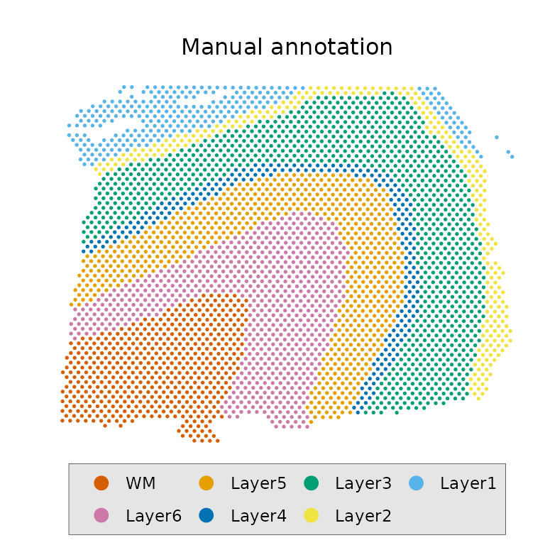
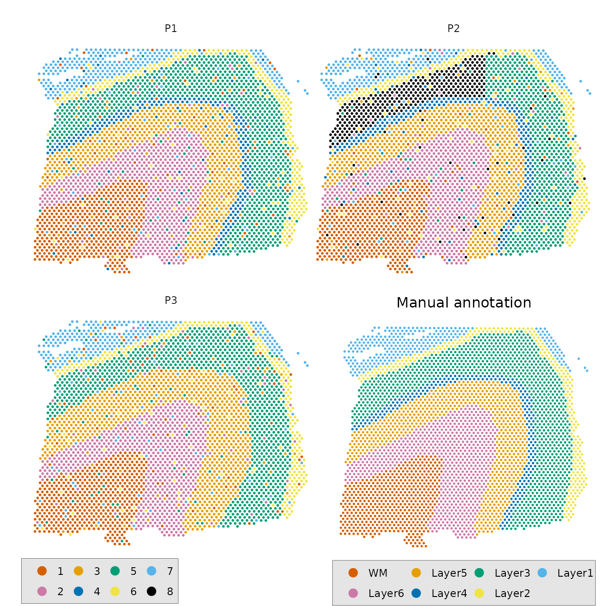
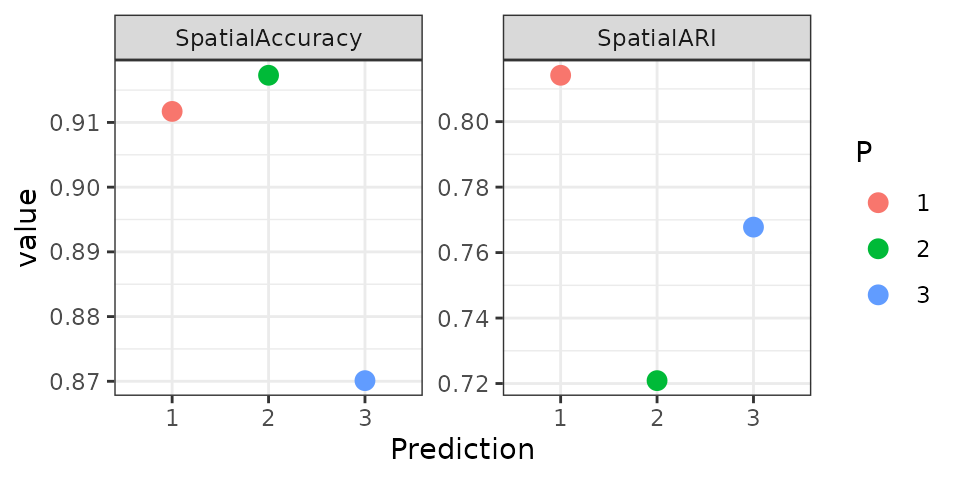
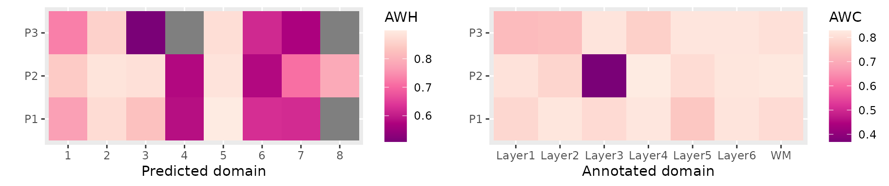
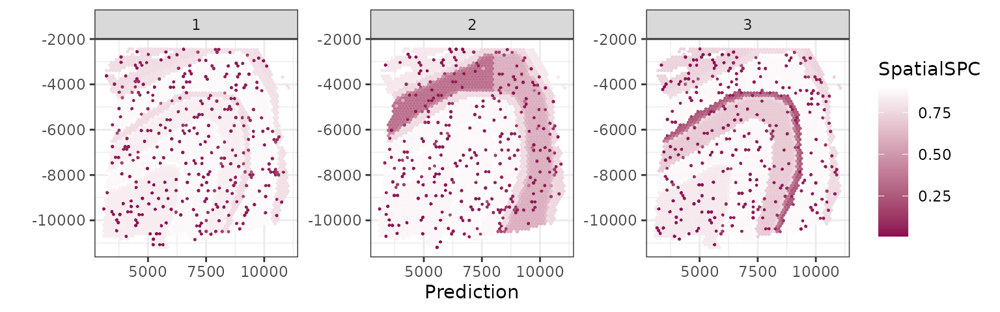
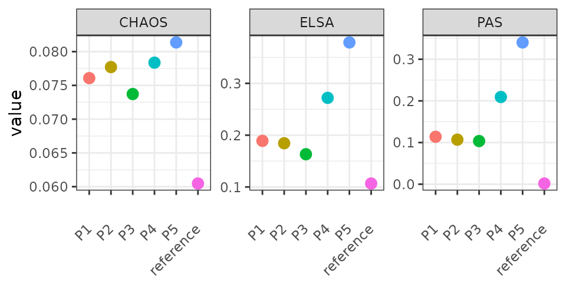
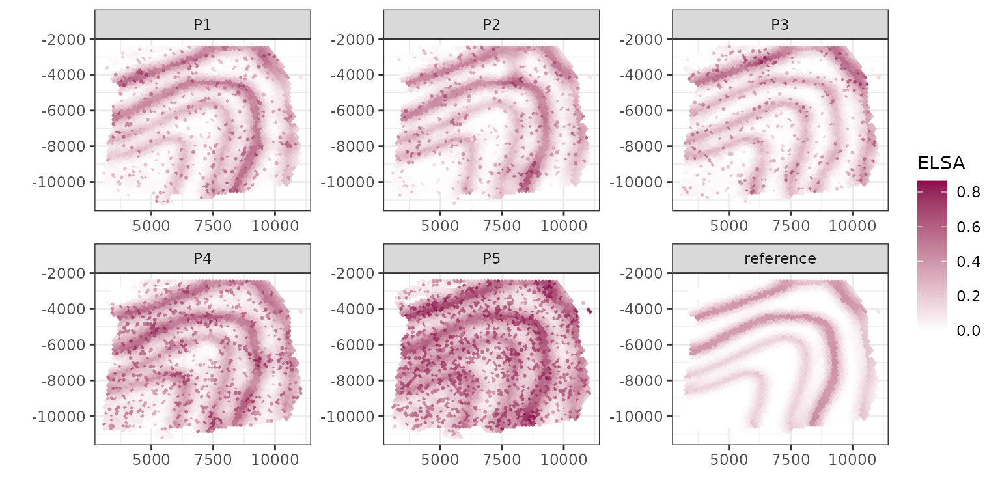

# Working with SpatialExperiment

## Prepare dataset

``` r
my_cols <-c("#D55E00", "#CC79A7","#E69F00","#0072B2","#009E73","#F0E442","#56B4E9","#000000")
names(my_cols) <- as.character(seq(my_cols))
```

Our package `poem` can be easily integrated into a workflow with
`SpatialExperiment` objects. Here we use the `Visium_humanDLPFC` dataset
from package `STexampleData` for illustration. Load it:

``` r
spe <- Visium_humanDLPFC()
spe
## class: SpatialExperiment 
## dim: 33538 4992 
## metadata(0):
## assays(1): counts
## rownames(33538): ENSG00000243485 ENSG00000237613 ... ENSG00000277475
##   ENSG00000268674
## rowData names(3): gene_id gene_name feature_type
## colnames(4992): AAACAACGAATAGTTC-1 AAACAAGTATCTCCCA-1 ...
##   TTGTTTGTATTACACG-1 TTGTTTGTGTAAATTC-1
## colData names(8): barcode_id sample_id ... reference cell_count
## reducedDimNames(0):
## mainExpName: NULL
## altExpNames(0):
## spatialCoords names(2) : pxl_col_in_fullres pxl_row_in_fullres
## imgData names(4): sample_id image_id data scaleFactor
```

From this `SpatialExperiment` object, we take the location information
(accessible via `spatialCoords`) and the manual annotation in `colData`
and store them as a dataframe:

``` r
data <- data.frame(spatialCoords(spe))
data$reference <- colData(spe)$reference
data <- na.omit(data)
data$reference <- factor(data$reference, levels=c("WM", "Layer6", "Layer5", 
                                                  "Layer4", "Layer3", "Layer2", 
                                                  "Layer1"))
```

The manual annotation looks like this:

``` r
p1 <- ggplot(data) +
  geom_point(aes(x = pxl_col_in_fullres, y = -pxl_row_in_fullres, color = reference), size=0.3) +
  labs(x = "", y = "", color="", title="Manual annotation") +
  theme_minimal() +
  scale_color_manual(values = unname(my_cols)) +
  theme(
  legend.box.background = element_rect(fill = "grey90", color = "black", size = 0.1),
  legend.box.margin = margin(-1, -1, -1, -1),
  axis.title.x=element_blank(),
  legend.position = "bottom",
  legend.box.spacing = margin(0),
  axis.text.x=element_blank(),
  axis.ticks.x=element_blank(),
  axis.text.y=element_blank(),
  axis.ticks.y=element_blank(),
  panel.spacing.x = unit(-0.5, "cm"),
  panel.grid.major = element_blank(), 
  panel.grid.minor = element_blank(),
  plot.title = element_text(hjust = 0.5, size=12, margin = margin(b = 5, t = 15))) +
  guides(color = guide_legend(keywidth = 1, keyheight = 0.8, override.aes = list(size = 3)))

p1
```



We then generate some hypothetical domain detection predictions by
randomly permuting the manual annotation.

``` r
set.seed(123) # For reproducibility

# Given a factor vector representing clustering results, simulate clustering variations including merging two clusters and adding random noise.
simulate_clustering_variation <- function(clusters, split_cluster = NULL, merge_clusters = NULL, noise_level = 0.1) {
  # Convert to numeric for easier manipulation
  merge_clusters <- which(levels(clusters) %in% merge_clusters)
  clusters <- as.numeric(clusters)

  # 1. Merging two clusters
  if (!is.null(merge_clusters)) {
    clusters[clusters %in% merge_clusters] <- merge_clusters[1] # Rename both to the same label
  }
  
  # 2. Adding random noise
  n <- length(clusters)
  n_noise <- round(n * noise_level) # Number of elements to replace
  if (n_noise > 0) {
    noise_indices <- sample(seq_len(n), n_noise) # Random indices to replace
    existing_levels <- unique(clusters)
    clusters[noise_indices] <- sample(existing_levels, n_noise, replace = TRUE) # Replace with random levels
  }
  
  # Convert back to factor and return
  factor(clusters)
}
```

Below we simulate some prediction results with random noise as well as
merging or splitting of domains:

``` r
# P1: add random noise
data$P1 <- simulate_clustering_variation(
  data$reference,
  noise_level = 0.1
)

# P2: split Layer 3 into 2 domains, add random noise
data$P2 <- as.numeric(data$reference)
data$P2[data$reference=="Layer3" & data$pxl_col_in_fullres < 8000] <- 8
data$P2 <- factor(as.numeric(factor(data$P2)))

data$P2 <- simulate_clustering_variation(
  data$P2,
  noise_level = 0.1
)

# P3: merge Layer 4 and Layer 5, add random noise
data$P3 <- simulate_clustering_variation(
  data$reference,
  merge_clusters = c("Layer4", "Layer5"),
  noise_level = 0.1
)
```

If we visualize them:

``` r
p2 <- data %>% pivot_longer(cols=-c("pxl_col_in_fullres","pxl_row_in_fullres"), 
                      names_to="prediction", values_to="domain") %>% 
  dplyr::filter(prediction != "reference") %>%
  ggplot() +
  geom_point(aes(x = pxl_col_in_fullres, y = -pxl_row_in_fullres, color = domain), size=0.4) +
  facet_wrap(~prediction, nrow=2) +
  labs(x = "", y = "", color="", title="") +
  theme_minimal() +
  scale_color_manual(values = unname(my_cols)) +
  theme(
  legend.box.background = element_rect(fill = "grey90", color = "black", size = 0.1),
  legend.box.margin = margin(-1, -1, -1, -1),
  axis.title.x=element_blank(),
  legend.position = "bottom",
  legend.justification=c(0, 0),
  legend.box.spacing = margin(0),
  axis.text.x=element_blank(),
  axis.ticks.x=element_blank(),
  axis.text.y=element_blank(),
  axis.ticks.y=element_blank(),
  panel.spacing.x = unit(-0.5, "cm"),
  panel.grid.major = element_blank(), 
  panel.grid.minor = element_blank(),
  plot.title = element_text(hjust = 0.5, size=10))  +
  guides(color = guide_legend(keywidth = 1, keyheight = 0.8, override.aes = list(size = 3)))

ggdraw() +
  draw_plot(p2 + theme(plot.margin = margin(0, 2, 2, 2))) +  # Main plot
  draw_plot(p1, x = 0.5, y = -0.01, width = 0.5, height = 0.56)  # Inset plot
```



## Calculate external spatial metrics

We can compare P1-P3 to the manual annotation using external spatial
metrics.

### Dataset level

Let’s first calculate two dataset-level metrics, SpatialARI and
SpatialAccuracy:

``` r
res3 <- getSpatialExternalMetrics(true=data$reference, pred=data$P3,
                                  location=data[,c("pxl_col_in_fullres","pxl_row_in_fullres")], level="dataset",
                                  metrics=c("SpatialARI","SpatialAccuracy"), k=6,
                                  fuzzy_true = TRUE, fuzzy_pred = FALSE)

res2 <- getSpatialExternalMetrics(true=data$reference, pred=data$P2,
                                  location=data[,c("pxl_col_in_fullres","pxl_row_in_fullres")], level="dataset",
                                  metrics=c("SpatialARI","SpatialAccuracy"), k=6,
                                  fuzzy_true = TRUE, fuzzy_pred = FALSE)

res1 <- getSpatialExternalMetrics(true=data$reference, pred=data$P1,
                                  location=data[,c("pxl_col_in_fullres","pxl_row_in_fullres")], level="dataset",
                                  metrics=c("SpatialARI","SpatialAccuracy"), k=6,
                                  fuzzy_true = TRUE, fuzzy_pred = FALSE)

cbind(bind_rows(list(res1, res2, res3), .id="P")) %>% 
  pivot_longer(cols=c("SpatialARI", "SpatialAccuracy"), 
               names_to="metric", values_to="value") %>%
  ggplot(aes(x=P, y=value, group=metric)) +
  geom_point(size=3, aes(color=P)) +
  facet_wrap(~metric, scales = "free") +
  theme_bw() + labs(x="Prediction")
```



### Class/cluster level

We can further calculate the class/cluster-level metrics, SpatialAWH and
SpatialAWC, to get more insights about the errors our predictions make:

``` r
res3 <- getSpatialExternalMetrics(true=data$reference, pred=data$P3,
                                  location=data[,c("pxl_col_in_fullres","pxl_row_in_fullres")], level="class",
                                  metrics=c("SpatialAWH","SpatialAWC"), k=6,
                                  fuzzy_true = TRUE, fuzzy_pred = FALSE)

res2 <- getSpatialExternalMetrics(true=data$reference, pred=data$P2,
                                  location=data[,c("pxl_col_in_fullres","pxl_row_in_fullres")], level="class",
                                  metrics=c("SpatialAWH","SpatialAWC"), k=6,
                                  fuzzy_true = TRUE, fuzzy_pred = FALSE)

res1 <- getSpatialExternalMetrics(true=data$reference, pred=data$P1,
                                  location=data[,c("pxl_col_in_fullres","pxl_row_in_fullres")], level="class",
                                  metrics=c("SpatialAWH","SpatialAWC"), k=6,
                                  fuzzy_true = TRUE, fuzzy_pred = FALSE)
res1
##    SpatialAWH SpatialAWC class cluster
## 1          NA  0.7963689     1      NA
## 2          NA  0.8145576     2      NA
## 3          NA  0.7561886     3      NA
## 4          NA  0.8184988     4      NA
## 5          NA  0.7949846     5      NA
## 6          NA  0.8179805     6      NA
## 7          NA  0.7884382     7      NA
## 8   0.7704762         NA    NA       1
## 9   0.8727733         NA    NA       2
## 10  0.8274801         NA    NA       3
## 11  0.5853277         NA    NA       4
## 12  0.8989078         NA    NA       5
## 13  0.6277691         NA    NA       6
## 14  0.6240081         NA    NA       7
```

Note that the indices in columns “class” and “cluster” correspond to the
levels of original factors passed to `true` and `pred`. We align them
back to the previous factor values, and then plot them in heatmap:

``` r
awh1 <- na.omit(res1[,c("SpatialAWH", "cluster")]) %>% mutate(cluster = levels(data$P1)[cluster])
awh2 <- na.omit(res2[,c("SpatialAWH", "cluster")]) %>% mutate(cluster = levels(data$P2)[cluster])
awh3 <- na.omit(res3[,c("SpatialAWH", "cluster")]) %>% mutate(cluster = levels(data$P3)[cluster])

awh <- cbind(bind_rows(list(awh1, awh2, awh3), .id="P")) %>% 
  pivot_wider(names_from = cluster, values_from = SpatialAWH) %>%
  subset(select = -c(P))
awh <- as.matrix(awh)
rownames(awh) <- c("P1", "P2", "P3")
awh <- awh[,c("1", "2", "3", "4", "5", "6", "7", "8")]

awh <- data.frame(awh)
colnames(awh) <- 1:8
awh$prediction <- rownames(awh)


p4 <- awh %>% pivot_longer(cols=-c("prediction"), names_to="cluster", values_to = "AWH") %>%
  mutate(prediction = factor(prediction), cluster=factor(cluster)) %>%
  ggplot(aes(cluster, prediction, fill=AWH)) +
  geom_tile() +
  scale_fill_distiller(palette = "RdPu") +
  labs(x="Predicted domain", y="")
```

``` r
awc1 <- na.omit(res1[,c("SpatialAWC", "class")]) %>% mutate(class = levels(data$reference)[class])
awc2 <- na.omit(res2[,c("SpatialAWC", "class")]) %>% mutate(class = levels(data$reference)[class])
awc3 <- na.omit(res3[,c("SpatialAWC", "class")]) %>% mutate(class = levels(data$reference)[class])

awc <- cbind(bind_rows(list(awc1, awc2, awc3), .id="P")) %>% 
  pivot_wider(names_from = class, values_from = SpatialAWC) %>%
  subset(select = -c(P))
awc <- as.matrix(awc)
rownames(awc) <- c("P1", "P2", "P3")


awc <- data.frame(awc)
awc$prediction <- rownames(awc)


p5 <- awc %>% pivot_longer(cols=-c("prediction"), names_to="class", values_to = "AWC") %>%
  mutate(prediction = factor(prediction), class=factor(class)) %>%
  ggplot(aes(class, prediction, fill=AWC)) +
  geom_tile() +
  scale_fill_distiller(palette = "RdPu") +
  labs(x="Annotated domain", y="")
```

``` r
plot_grid(p4, p5, rel_widths=c(1,1), scale=c(1, 1))
```



The class-level AWC highlights that in P2, Layer3 has low completeness.
This align with our simulation that Layer3 is splitted into 3 clusters
in P2. Similarly, the cluster-level AWH highlights that in P3, cluster 3
has low homogeneity, consistent with the merging of layer 4 and 5.

### Element level

One can also calculate element-level metric, SPC, for visualization.

``` r
res1 <- cbind(getSpatialExternalMetrics(true=data$reference, pred=data$P1,
                                  location=data[,c("pxl_col_in_fullres","pxl_row_in_fullres")], level="element",
                                  metrics=c("SpatialSPC"), k=6,
                                  fuzzy_true = TRUE, fuzzy_pred = FALSE, useNegatives = FALSE), 
              data[,c("pxl_col_in_fullres", "pxl_row_in_fullres")])

res2 <- cbind(getSpatialExternalMetrics(true=data$reference, pred=data$P2,
                                  location=data[,c("pxl_col_in_fullres","pxl_row_in_fullres")], level="element",
                                  metrics=c("SpatialSPC"), k=6,
                                  fuzzy_true = TRUE, fuzzy_pred = FALSE, useNegatives = FALSE),
               data[,c("pxl_col_in_fullres", "pxl_row_in_fullres")])

res3 <- cbind(getSpatialExternalMetrics(true=data$reference, pred=data$P3,
                                  location=data[,c("pxl_col_in_fullres","pxl_row_in_fullres")], level="element",
                                  metrics=c("SpatialSPC"), k=6,
                                  fuzzy_true = TRUE, fuzzy_pred = FALSE, useNegatives = FALSE),
               data[,c("pxl_col_in_fullres", "pxl_row_in_fullres")])


cbind(bind_rows(list(res1, res2, res3), .id="P")) %>% 
  pivot_longer(cols=c("SpatialSPC"), 
               names_to="metric", values_to="value") %>%
  ggplot(aes(x = pxl_col_in_fullres, y = - pxl_row_in_fullres, color = value)) +
  scale_colour_gradient(high="white", low ="deeppink4") +
  geom_point(size=0.3) +
  facet_wrap(~P, scales = "free") +
  theme_bw() + labs(x="Prediction", y="", color="SpatialSPC")
```

 This
clear highlights the low concordance regions in each prediction as
expected.

## Calculate internal spatial metrics

When the manual annotation is not available, one can use internal
metrics, CHAOS, ELSA and PAS, to understand the domain continuity and
local homogeneity for a domain detection result. To illustrate this, we
simulate P4 and P5 with 20% and 30% random noise, respectively.

``` r
# P4: add 20% random noise 
data$P4 <- simulate_clustering_variation(
  data$reference,
  noise_level = 0.2
)

# P5: add 30% random noise
data$P5 <- simulate_clustering_variation(
  data$reference,
  noise_level = 0.3
)
```

We calculate the internal spatial metrics for P1-P5:

``` r
internal <-lapply(setNames(c("reference","P1","P2","P3","P4","P5"), c("reference","P1","P2","P3","P4","P5")),
                  function(x){getSpatialInternalMetrics(data[[x]],                                                                                                             location=data[,c("pxl_col_in_fullres","pxl_row_in_fullres")],
                                                        k=6, level="dataset", 
                                                        metrics=c("PAS", "ELSA", "CHAOS"))})
## the specified variable is considered as categorical...
## the specified variable is considered as categorical...
## the specified variable is considered as categorical...
## the specified variable is considered as categorical...
## the specified variable is considered as categorical...
## the specified variable is considered as categorical...
internal <- bind_rows(internal,.id = "prediction")
```

``` r
internal %>% 
  pivot_longer(cols=-c("prediction"), 
               names_to="metric", values_to="value") %>%
  filter(metric %in% c("ELSA", "PAS", "CHAOS")) %>%
  ggplot(aes(x=prediction, y=value, group=metric)) +
  geom_point(size=3, aes(color=prediction)) +
  facet_wrap(~metric, scales = "free") +
  theme_bw() + labs(x="", color="") +
  theme(legend.position="None",
        axis.text.x = element_text(angle = 45, vjust = 0.5, hjust = 1))
```



The lower the scores, the smoother the predictions. As expected, the
smoothness decrease from P3 to P5 as the noise level increase.

The internal metrics can also be calculated at the element level. For
example we can calculate the element-wise ELSA score, which is a score
for local diversity and can be regarded as edge detector:

``` r
internal <-lapply(setNames(c("reference","P1","P2","P3","P4","P5"), c("reference","P1","P2","P3","P4","P5")),
                  function(x){cbind(
                    getSpatialInternalMetrics(data[[x]],
                                              location = data[,c("pxl_col_in_fullres","pxl_row_in_fullres")],
                                              k=6, level="element", metrics=c( "ELSA")), 
                    data[,c("pxl_col_in_fullres", "pxl_row_in_fullres")])})
## the specified variable is considered as categorical...
## the specified variable is considered as categorical...
## the specified variable is considered as categorical...
## the specified variable is considered as categorical...
## the specified variable is considered as categorical...
## the specified variable is considered as categorical...
internal <- bind_rows(internal,.id = "prediction")

internal %>%
  ggplot(aes(x = pxl_col_in_fullres, y = - pxl_row_in_fullres, color = ELSA)) +
  scale_colour_gradient(low="white", high="deeppink4") +
  geom_point(size=0.4) +
  facet_wrap(~prediction, scales = "free") +
  theme_bw() + labs(x="", y="", color="ELSA")
```



## Session info

``` r
sessionInfo()
## R version 4.4.2 (2024-10-31)
## Platform: x86_64-pc-linux-gnu
## Running under: Ubuntu 22.04.5 LTS
## 
## Matrix products: default
## BLAS:   /usr/lib/x86_64-linux-gnu/blas/libblas.so.3.10.0 
## LAPACK: /usr/lib/x86_64-linux-gnu/lapack/liblapack.so.3.10.0
## 
## locale:
##  [1] LC_CTYPE=en_US.UTF-8       LC_NUMERIC=C              
##  [3] LC_TIME=en_US.UTF-8        LC_COLLATE=en_US.UTF-8    
##  [5] LC_MONETARY=en_US.UTF-8    LC_MESSAGES=en_US.UTF-8   
##  [7] LC_PAPER=en_US.UTF-8       LC_NAME=C                 
##  [9] LC_ADDRESS=C               LC_TELEPHONE=C            
## [11] LC_MEASUREMENT=en_US.UTF-8 LC_IDENTIFICATION=C       
## 
## time zone: Europe/Zurich
## tzcode source: system (glibc)
## 
## attached base packages:
## [1] stats4    stats     graphics  grDevices utils     datasets  methods  
## [8] base     
## 
## other attached packages:
##  [1] tidyr_1.3.1                 dplyr_1.1.4                
##  [3] STexampleData_1.12.3        ExperimentHub_2.12.0       
##  [5] AnnotationHub_3.12.0        BiocFileCache_2.12.0       
##  [7] dbplyr_2.5.0                SpatialExperiment_1.14.0   
##  [9] SingleCellExperiment_1.26.0 SummarizedExperiment_1.34.0
## [11] Biobase_2.64.0              GenomicRanges_1.56.1       
## [13] GenomeInfoDb_1.40.1         IRanges_2.38.1             
## [15] S4Vectors_0.42.1            BiocGenerics_0.50.0        
## [17] MatrixGenerics_1.16.0       matrixStats_1.3.0          
## [19] cowplot_1.1.3               ggplot2_3.5.1              
## [21] poem_0.99.2                 BiocStyle_2.32.1           
## 
## loaded via a namespace (and not attached):
##   [1] RColorBrewer_1.1-3      rstudioapi_0.16.0       jsonlite_1.8.8         
##   [4] wk_0.9.4                magrittr_2.0.3          magick_2.8.4           
##   [7] farver_2.1.2            rmarkdown_2.27          fs_1.6.4               
##  [10] zlibbioc_1.50.0         ragg_1.3.2              vctrs_0.6.5            
##  [13] spdep_1.3-6             memoise_2.0.1           elsa_1.1-28            
##  [16] terra_1.5-21            htmltools_0.5.8.1       S4Arrays_1.4.1         
##  [19] curl_5.2.1              BiocNeighbors_1.22.0    raster_3.5-15          
##  [22] s2_1.1.7                SparseArray_1.4.8       sass_0.4.9             
##  [25] spData_2.3.3            KernSmooth_2.23-24      bslib_0.8.0            
##  [28] htmlwidgets_1.6.4       desc_1.4.3              cachem_1.1.0           
##  [31] igraph_2.1.1            mime_0.12               lifecycle_1.0.4        
##  [34] pkgconfig_2.0.3         Matrix_1.7-0            R6_2.5.1               
##  [37] fastmap_1.2.0           GenomeInfoDbData_1.2.12 rbibutils_2.3          
##  [40] aricode_1.0.3           clue_0.3-65             digest_0.6.36          
##  [43] colorspace_2.1-1        AnnotationDbi_1.66.0    textshaping_0.3.6      
##  [46] RSQLite_2.3.7           labeling_0.4.3          filelock_1.0.3         
##  [49] fansi_1.0.6             httr_1.4.7              abind_1.4-5            
##  [52] compiler_4.4.2          proxy_0.4-27            bit64_4.0.5            
##  [55] withr_3.0.1             BiocParallel_1.38.0     DBI_1.2.3              
##  [58] highr_0.11              MASS_7.3-61             rappdirs_0.3.3         
##  [61] DelayedArray_0.30.1     rjson_0.2.21            classInt_0.4-10        
##  [64] bluster_1.14.0          tools_4.4.2             units_0.8-0            
##  [67] glue_1.8.0              dbscan_1.2-0            grid_4.4.2             
##  [70] sf_1.0-6                cluster_2.1.6           generics_0.1.3         
##  [73] gtable_0.3.5            clevr_0.1.2             class_7.3-22           
##  [76] fclust_2.1.1.1          sp_2.1-4                utf8_1.2.4             
##  [79] XVector_0.44.0          BiocVersion_3.19.1      pillar_1.9.0           
##  [82] lattice_0.22-6          bit_4.0.5               deldir_2.0-4           
##  [85] tidyselect_1.2.1        Biostrings_2.72.1       knitr_1.48             
##  [88] bookdown_0.40           xfun_0.46               UCSC.utils_1.0.0       
##  [91] yaml_2.3.10             boot_1.3-30             evaluate_0.24.0        
##  [94] codetools_0.2-20        tibble_3.2.1            mclustcomp_0.3.3       
##  [97] BiocManager_1.30.23     cli_3.6.3               systemfonts_1.1.0      
## [100] Rdpack_2.6.1            munsell_0.5.1           jquerylib_0.1.4        
## [103] Rcpp_1.0.13             png_0.1-8               parallel_4.4.2         
## [106] pkgdown_2.1.1           blob_1.2.4              scales_1.3.0           
## [109] e1071_1.7-9             purrr_1.0.2             crayon_1.5.3           
## [112] rlang_1.1.4             KEGGREST_1.44.1
```
