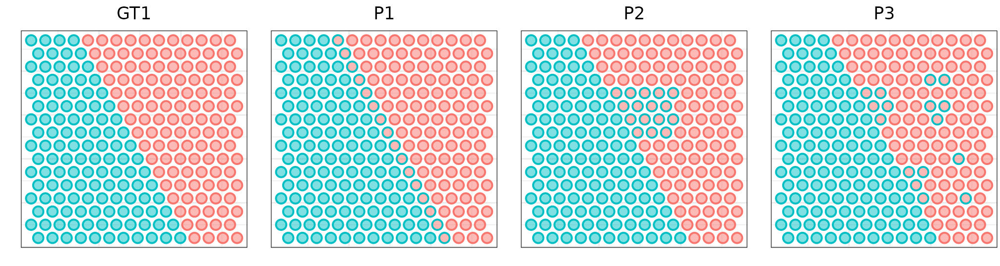

# Fuzzy metrics

## Load the data

``` r
data("sp_toys")
data <- sp_toys
s <- 3
st <- 1
p0 <- ggplot(data, aes(x, y, 
               color=label)) + 
  geom_point(size=s, alpha=0.5) + scale_y_reverse() + theme_bw() +
  geom_point(shape = 1, size = s, stroke = st, aes(color=label)) + 
  labs(x="",y="", title="GT1") 


p1 <- ggplot(data, aes(x, y, 
               color=label)) + 
  geom_point(size=s, alpha=0.5) + scale_y_reverse() + theme_bw() +
  geom_point(shape = 1, size = s, stroke = st, aes(color=p1)) + 
  labs(x="",y="", title="P1") 


p2 <- ggplot(data, aes(x, y, 
               color=label)) + 
  geom_point(size=s, alpha=0.5) + scale_y_reverse() + theme_bw() +
  geom_point(shape = 1, size = s, stroke = st, aes(color=p2)) + 
  labs(x="",y="", title="P2") 

p3 <- ggplot(data, aes(x, y, 
               color=label)) + 
  geom_point(size=s, alpha=0.5) + scale_y_reverse() + theme_bw() +
  geom_point(shape = 1, size = s, stroke = st, aes(color=p3)) + 
  labs(x="",y="", title="P3") 

ps1 <- plot_grid(
    p0 + theme(legend.position = "none", plot.title = element_text(hjust = 0.5), plot.margin = margin(5, 2, -2, 0), 
    axis.text.x = element_blank(), axis.text.y = element_blank(),axis.ticks.x = element_blank(), axis.ticks.y = element_blank()),
    p1 + theme(legend.position = "none", plot.title = element_text(hjust = 0.5), plot.margin = margin(5, 2, -2, 0),
    axis.text.x = element_blank(), axis.text.y = element_blank(),axis.ticks.x = element_blank(), axis.ticks.y = element_blank()), 
    p2 + theme(legend.position = "none", plot.title = element_text(hjust = 0.5), plot.margin = margin(5, 2, -2, 0),
    axis.text.x = element_blank(), axis.text.y = element_blank(),axis.ticks.x = element_blank(), axis.ticks.y = element_blank()), 
    p3 + theme(legend.position = "none", plot.title = element_text(hjust = 0.5), plot.margin = margin(5, 2, -2, 0),
    axis.text.x = element_blank(), axis.text.y = element_blank(),axis.ticks.x = element_blank(), axis.ticks.y = element_blank()),
    ncol = 4)
plot(ps1)
```



``` r
gt1 <- getFuzzyLabel(data$label, data[,c("x","y")], k=6, alpha=0.5)
gt1
##             1         2
## 1   0.0000000 1.0000000
## 2   0.0000000 1.0000000
## 3   0.0000000 1.0000000
## 4   0.1428571 0.8571429
## 5   0.6666667 0.3333333
## 6   1.0000000 0.0000000
## 7   1.0000000 0.0000000
## 8   1.0000000 0.0000000
## 9   1.0000000 0.0000000
## 10  1.0000000 0.0000000
## 11  1.0000000 0.0000000
## 12  1.0000000 0.0000000
## 13  1.0000000 0.0000000
## 14  1.0000000 0.0000000
## 15  1.0000000 0.0000000
## 16  0.0000000 1.0000000
## 17  0.0000000 1.0000000
## 18  0.0000000 1.0000000
## 19  0.1666667 0.8333333
## 20  0.8333333 0.1666667
## 21  1.0000000 0.0000000
## 22  1.0000000 0.0000000
## 23  1.0000000 0.0000000
## 24  1.0000000 0.0000000
## 25  1.0000000 0.0000000
## 26  1.0000000 0.0000000
## 27  1.0000000 0.0000000
## 28  1.0000000 0.0000000
## 29  1.0000000 0.0000000
## 30  1.0000000 0.0000000
## 31  0.0000000 1.0000000
## 32  0.0000000 1.0000000
## 33  0.0000000 1.0000000
## 34  0.0000000 1.0000000
## 35  0.1666667 0.8333333
## 36  0.8333333 0.1666667
## 37  1.0000000 0.0000000
## 38  1.0000000 0.0000000
## 39  1.0000000 0.0000000
## 40  1.0000000 0.0000000
## 41  1.0000000 0.0000000
## 42  1.0000000 0.0000000
## 43  1.0000000 0.0000000
## 44  1.0000000 0.0000000
## 45  1.0000000 0.0000000
## 46  0.0000000 1.0000000
## 47  0.0000000 1.0000000
## 48  0.0000000 1.0000000
## 49  0.0000000 1.0000000
## 50  0.1666667 0.8333333
## 51  0.8333333 0.1666667
## 52  1.0000000 0.0000000
## 53  1.0000000 0.0000000
## 54  1.0000000 0.0000000
## 55  1.0000000 0.0000000
## 56  1.0000000 0.0000000
## 57  1.0000000 0.0000000
## 58  1.0000000 0.0000000
## 59  1.0000000 0.0000000
## 60  1.0000000 0.0000000
## 61  0.0000000 1.0000000
## 62  0.0000000 1.0000000
## 63  0.0000000 1.0000000
## 64  0.0000000 1.0000000
## 65  0.0000000 1.0000000
## 66  0.1666667 0.8333333
## 67  0.8333333 0.1666667
## 68  1.0000000 0.0000000
## 69  1.0000000 0.0000000
## 70  1.0000000 0.0000000
## 71  1.0000000 0.0000000
## 72  1.0000000 0.0000000
## 73  1.0000000 0.0000000
## 74  1.0000000 0.0000000
## 75  1.0000000 0.0000000
## 76  0.0000000 1.0000000
## 77  0.0000000 1.0000000
## 78  0.0000000 1.0000000
## 79  0.0000000 1.0000000
## 80  0.0000000 1.0000000
## 81  0.1666667 0.8333333
## 82  0.8333333 0.1666667
## 83  1.0000000 0.0000000
## 84  1.0000000 0.0000000
## 85  1.0000000 0.0000000
## 86  1.0000000 0.0000000
## 87  1.0000000 0.0000000
## 88  1.0000000 0.0000000
## 89  1.0000000 0.0000000
## 90  1.0000000 0.0000000
## 91  0.0000000 1.0000000
## 92  0.0000000 1.0000000
## 93  0.0000000 1.0000000
## 94  0.0000000 1.0000000
## 95  0.0000000 1.0000000
## 96  0.0000000 1.0000000
## 97  0.1666667 0.8333333
## 98  0.8333333 0.1666667
## 99  1.0000000 0.0000000
## 100 1.0000000 0.0000000
## 101 1.0000000 0.0000000
## 102 1.0000000 0.0000000
## 103 1.0000000 0.0000000
## 104 1.0000000 0.0000000
## 105 1.0000000 0.0000000
## 106 0.0000000 1.0000000
## 107 0.0000000 1.0000000
## 108 0.0000000 1.0000000
## 109 0.0000000 1.0000000
## 110 0.0000000 1.0000000
## 111 0.0000000 1.0000000
## 112 0.1666667 0.8333333
## 113 0.8333333 0.1666667
## 114 1.0000000 0.0000000
## 115 1.0000000 0.0000000
## 116 1.0000000 0.0000000
## 117 1.0000000 0.0000000
## 118 1.0000000 0.0000000
## 119 1.0000000 0.0000000
## 120 1.0000000 0.0000000
## 121 0.0000000 1.0000000
## 122 0.0000000 1.0000000
## 123 0.0000000 1.0000000
## 124 0.0000000 1.0000000
## 125 0.0000000 1.0000000
## 126 0.0000000 1.0000000
## 127 0.0000000 1.0000000
## 128 0.1666667 0.8333333
## 129 0.8333333 0.1666667
## 130 1.0000000 0.0000000
## 131 1.0000000 0.0000000
## 132 1.0000000 0.0000000
## 133 1.0000000 0.0000000
## 134 1.0000000 0.0000000
## 135 1.0000000 0.0000000
## 136 0.0000000 1.0000000
## 137 0.0000000 1.0000000
## 138 0.0000000 1.0000000
## 139 0.0000000 1.0000000
## 140 0.0000000 1.0000000
## 141 0.0000000 1.0000000
## 142 0.0000000 1.0000000
## 143 0.1666667 0.8333333
## 144 0.8333333 0.1666667
## 145 1.0000000 0.0000000
## 146 1.0000000 0.0000000
## 147 1.0000000 0.0000000
## 148 1.0000000 0.0000000
## 149 1.0000000 0.0000000
## 150 1.0000000 0.0000000
## 151 0.0000000 1.0000000
## 152 0.0000000 1.0000000
## 153 0.0000000 1.0000000
## 154 0.0000000 1.0000000
## 155 0.0000000 1.0000000
## 156 0.0000000 1.0000000
## 157 0.0000000 1.0000000
## 158 0.0000000 1.0000000
## 159 0.1666667 0.8333333
## 160 0.8333333 0.1666667
## 161 1.0000000 0.0000000
## 162 1.0000000 0.0000000
## 163 1.0000000 0.0000000
## 164 1.0000000 0.0000000
## 165 1.0000000 0.0000000
## 166 0.0000000 1.0000000
## 167 0.0000000 1.0000000
## 168 0.0000000 1.0000000
## 169 0.0000000 1.0000000
## 170 0.0000000 1.0000000
## 171 0.0000000 1.0000000
## 172 0.0000000 1.0000000
## 173 0.0000000 1.0000000
## 174 0.1666667 0.8333333
## 175 0.8333333 0.1666667
## 176 1.0000000 0.0000000
## 177 1.0000000 0.0000000
## 178 1.0000000 0.0000000
## 179 1.0000000 0.0000000
## 180 1.0000000 0.0000000
## 181 0.0000000 1.0000000
## 182 0.0000000 1.0000000
## 183 0.0000000 1.0000000
## 184 0.0000000 1.0000000
## 185 0.0000000 1.0000000
## 186 0.0000000 1.0000000
## 187 0.0000000 1.0000000
## 188 0.0000000 1.0000000
## 189 0.0000000 1.0000000
## 190 0.1666667 0.8333333
## 191 0.8333333 0.1666667
## 192 1.0000000 0.0000000
## 193 1.0000000 0.0000000
## 194 1.0000000 0.0000000
## 195 1.0000000 0.0000000
## 196 0.0000000 1.0000000
## 197 0.0000000 1.0000000
## 198 0.0000000 1.0000000
## 199 0.0000000 1.0000000
## 200 0.0000000 1.0000000
## 201 0.0000000 1.0000000
## 202 0.0000000 1.0000000
## 203 0.0000000 1.0000000
## 204 0.0000000 1.0000000
## 205 0.1666667 0.8333333
## 206 0.8333333 0.1666667
## 207 1.0000000 0.0000000
## 208 1.0000000 0.0000000
## 209 1.0000000 0.0000000
## 210 1.0000000 0.0000000
## 211 0.0000000 1.0000000
## 212 0.0000000 1.0000000
## 213 0.0000000 1.0000000
## 214 0.0000000 1.0000000
## 215 0.0000000 1.0000000
## 216 0.0000000 1.0000000
## 217 0.0000000 1.0000000
## 218 0.0000000 1.0000000
## 219 0.0000000 1.0000000
## 220 0.0000000 1.0000000
## 221 0.1666667 0.8333333
## 222 0.8333333 0.1666667
## 223 1.0000000 0.0000000
## 224 1.0000000 0.0000000
## 225 1.0000000 0.0000000
## 226 0.0000000 1.0000000
## 227 0.0000000 1.0000000
## 228 0.0000000 1.0000000
## 229 0.0000000 1.0000000
## 230 0.0000000 1.0000000
## 231 0.0000000 1.0000000
## 232 0.0000000 1.0000000
## 233 0.0000000 1.0000000
## 234 0.0000000 1.0000000
## 235 0.0000000 1.0000000
## 236 0.2857143 0.7142857
## 237 0.8571429 0.1428571
## 238 1.0000000 0.0000000
## 239 1.0000000 0.0000000
## 240 1.0000000 0.0000000
```

## External metrics

### Pair counting-based metrics

### Reflexive property

a comparison of any clustering result with itself achieves the maximum
of the index.

``` r
fuzzyPartitionMetrics(gt1, gt1)
## $NDC
## [1] 1
## 
## $ACI
## [1] 1
## 
## $fuzzyWH
## $fuzzyWH$global
## [1] 1
## 
## $fuzzyWH$perPartition
## 1 2 
## 1 1 
## 
## 
## $fuzzyWC
## $fuzzyWC$global
## [1] 1
## 
## $fuzzyWC$perPartition
## 1 2 
## 1 1 
## 
## 
## $fuzzyAWH
## $fuzzyAWH$global
## [1] 1
## 
## $fuzzyAWH$perPartition
## 1 2 
## 1 1 
## 
## 
## $fuzzyAWC
## $fuzzyAWC$global
## [1] 1
## 
## $fuzzyAWC$perPartition
## 1 2 
## 1 1
fuzzyHardMetrics(data$label, gt1, data$label)
## $NDC
## [1] 1
## 
## $ACI
## [1] 1
## 
## $fuzzyWH
## $fuzzyWH$global
## [1] 1
## 
## $fuzzyWH$perPartition
## 1 2 
## 1 1 
## 
## 
## $fuzzyWC
## $fuzzyWC$global
## [1] 1
## 
## $fuzzyWC$perPartition
## 1 2 
## 1 1 
## 
## 
## $fuzzyAWH
## $fuzzyAWH$global
## [1] 1
## 
## $fuzzyAWH$perPartition
## 1 2 
## 1 1 
## 
## 
## $fuzzyAWC
## $fuzzyAWC$global
## [1] 1
## 
## $fuzzyAWC$perPartition
## 1 2 
## 1 1
```

### Comparing two clusterings of different cluster numbers

## Session info

``` r
sessionInfo()
## R version 4.4.2 (2024-10-31)
## Platform: x86_64-pc-linux-gnu
## Running under: Ubuntu 22.04.5 LTS
## 
## Matrix products: default
## BLAS:   /usr/lib/x86_64-linux-gnu/blas/libblas.so.3.10.0 
## LAPACK: /usr/lib/x86_64-linux-gnu/lapack/liblapack.so.3.10.0
## 
## locale:
##  [1] LC_CTYPE=en_US.UTF-8       LC_NUMERIC=C              
##  [3] LC_TIME=en_US.UTF-8        LC_COLLATE=en_US.UTF-8    
##  [5] LC_MONETARY=en_US.UTF-8    LC_MESSAGES=en_US.UTF-8   
##  [7] LC_PAPER=en_US.UTF-8       LC_NAME=C                 
##  [9] LC_ADDRESS=C               LC_TELEPHONE=C            
## [11] LC_MEASUREMENT=en_US.UTF-8 LC_IDENTIFICATION=C       
## 
## time zone: Europe/Zurich
## tzcode source: system (glibc)
## 
## attached base packages:
## [1] stats     graphics  grDevices utils     datasets  methods   base     
## 
## other attached packages:
## [1] cowplot_1.1.3    ggplot2_3.5.1    poem_0.99.2      BiocStyle_2.32.1
## 
## loaded via a namespace (and not attached):
##  [1] tidyselect_1.2.1     dplyr_1.1.4          farver_2.1.2        
##  [4] fastmap_1.2.0        bluster_1.14.0       digest_0.6.36       
##  [7] lifecycle_1.0.4      sf_1.0-6             cluster_2.1.6       
## [10] terra_1.5-21         magrittr_2.0.3       compiler_4.4.2      
## [13] rlang_1.1.4          sass_0.4.9           tools_4.4.2         
## [16] mclustcomp_0.3.3     igraph_2.1.1         utf8_1.2.4          
## [19] yaml_2.3.10          knitr_1.48           labeling_0.4.3      
## [22] htmlwidgets_1.6.4    sp_2.1-4             classInt_0.4-10     
## [25] BiocParallel_1.38.0  KernSmooth_2.23-24   fclust_2.1.1.1      
## [28] elsa_1.1-28          withr_3.0.1          BiocGenerics_0.50.0 
## [31] desc_1.4.3           grid_4.4.2           stats4_4.4.2        
## [34] fansi_1.0.6          e1071_1.7-9          colorspace_2.1-1    
## [37] aricode_1.0.3        scales_1.3.0         MASS_7.3-61         
## [40] cli_3.6.3            rmarkdown_2.27       ragg_1.3.2          
## [43] generics_0.1.3       rstudioapi_0.16.0    spdep_1.3-6         
## [46] DBI_1.2.3            cachem_1.1.0         proxy_0.4-27        
## [49] parallel_4.4.2       BiocManager_1.30.23  s2_1.1.7            
## [52] vctrs_0.6.5          boot_1.3-30          Matrix_1.7-0        
## [55] jsonlite_1.8.8       spData_2.3.3         bookdown_0.40       
## [58] clevr_0.1.2          S4Vectors_0.42.1     BiocNeighbors_1.22.0
## [61] clue_0.3-65          systemfonts_1.1.0    jquerylib_0.1.4     
## [64] units_0.8-0          glue_1.8.0           pkgdown_2.1.1       
## [67] codetools_0.2-20     gtable_0.3.5         deldir_2.0-4        
## [70] raster_3.5-15        munsell_0.5.1        tibble_3.2.1        
## [73] pillar_1.9.0         htmltools_0.5.8.1    R6_2.5.1            
## [76] wk_0.9.4             textshaping_0.3.6    Rdpack_2.6.1        
## [79] evaluate_0.24.0      lattice_0.22-6       highr_0.11          
## [82] rbibutils_2.3        bslib_0.8.0          class_7.3-22        
## [85] Rcpp_1.0.13          xfun_0.46            fs_1.6.4            
## [88] pkgconfig_2.0.3
```
