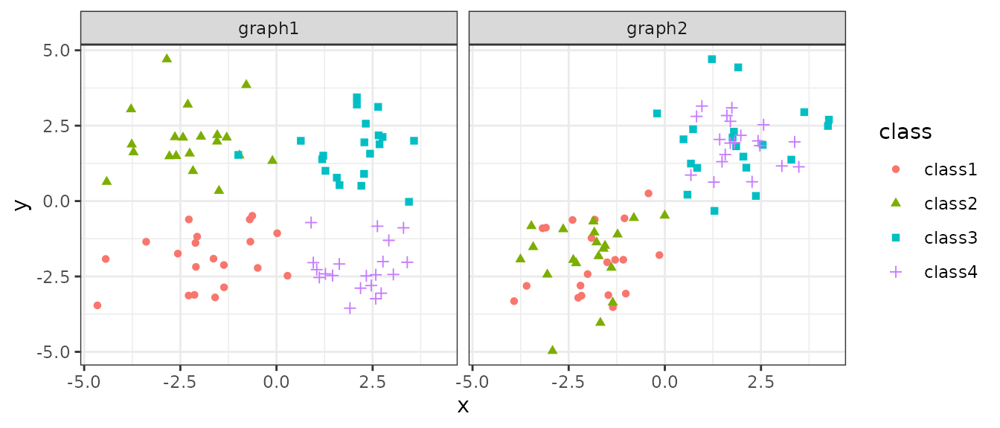
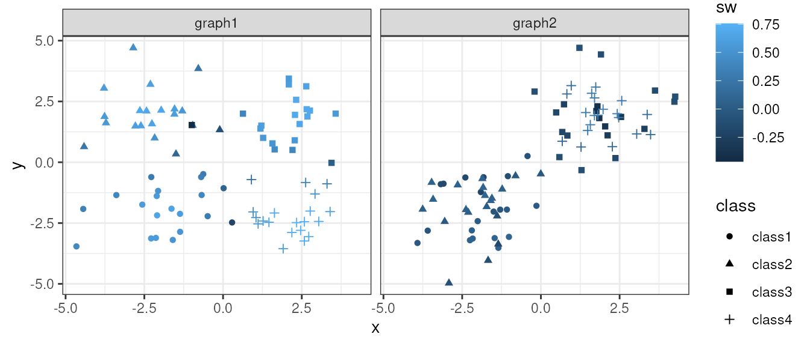
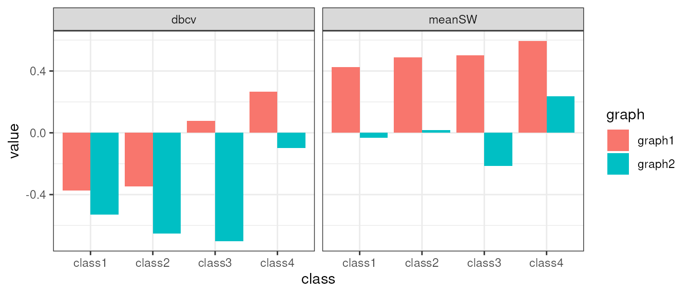
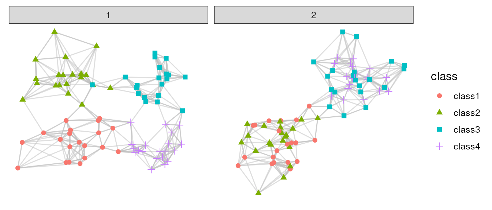
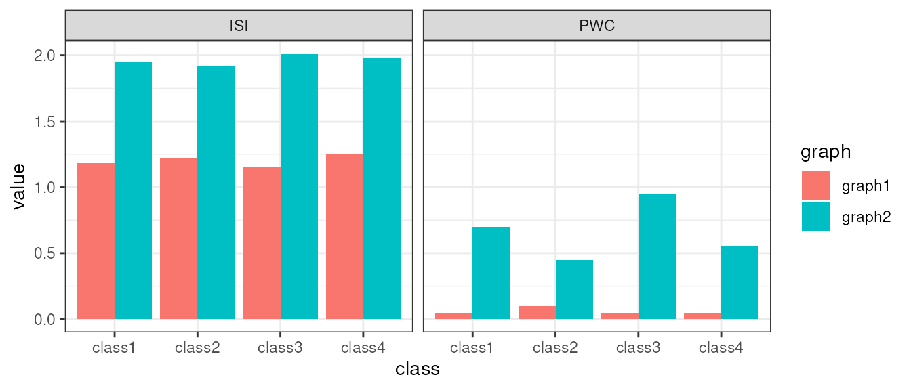
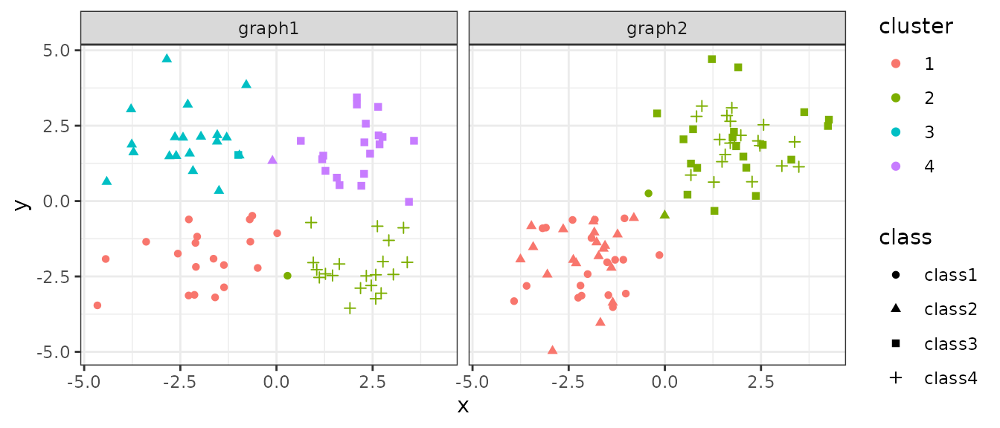
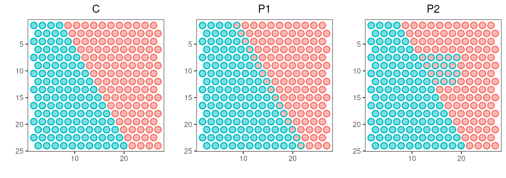
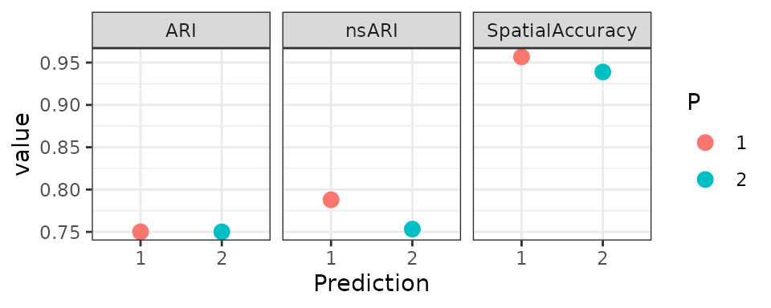
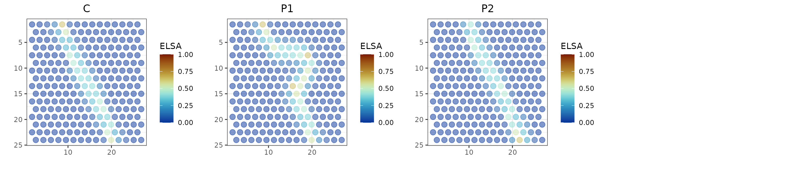

# Introduction to \`poem\`

## Installation & loading

``` r
if (!requireNamespace("BiocManager", quietly = TRUE))
    install.packages("BiocManager")
BiocManager::install("poem")
```

``` r
library(poem)
library(ggplot2)
library(dplyr)
library(tidyr)
library(ggnetwork)
library(igraph)
library(cowplot)
```

## Introduction

### What is this package for?

This package provides multiple approaches for comparing two
partitions[^1] of the same dataset, and evaluating the alignment between
a dataset’s embedding/graph representations and its partition.

Besides, this package further offers methods for comparing two fuzzy
partitions[^2] as well as for comparing a hard partition with a fuzzy
partition. This allows the evaluation of fuzzy partition results by
assessing its agreement to a fuzzy or a hard ground-truth partition.

Finally, the package implements visualization and evaluation metrics
tailored for domain detection in spatially-resolved -omics data. These
include especially external evaluation metrics (i.e. based on a
comparison to ground truth labels), but also internal metrics. For a
detailed description on how to work with
*[SpatialExperiment](https://bioconductor.org/packages/3.23/SpatialExperiment)*
objects, we refer to another vignette of
*[poem](https://bioconductor.org/packages/3.23/poem/vignettes/PoemOnSpatialExperiment.html)*.

### Main functions

The package *poem* includes many metrics to perform different kinds of
evaluations, and these metrics can be retrieved via 6 main wrapper
functions. Unless specified, “partition” means “hard” partition. They
are:

- [`getEmbeddingMetrics()`](https://roseyuan.github.io/poem/reference/getEmbeddingMetrics.md):
  Metrics to compare an embedding of data points to a partition of these
  data points.
- [`getGraphMetrics()`](https://roseyuan.github.io/poem/reference/getGraphMetrics.md):
  Metrics to compare a graph (e.g. kNN/sNN) to a partition, where nodes
  in the graph are data points in the partition.
- [`getPartitionMetrics()`](https://roseyuan.github.io/poem/reference/getPartitionMetrics.md):
  Metrics to compare two partitions of the same dataset.
- `getfuzzyPartitionMetrics()`: Metrics to compare two fuzzy partitions,
  or to compare between a fuzzy and a hard partition of the same
  dataset.
- [`getSpatialExternalMetrics()`](https://roseyuan.github.io/poem/reference/getSpatialExternalMetrics.md):
  External metrics for evaluating spatial clustering results in a
  spatial-aware fashion. For non-spatial-aware evaluation, one can
  directly use
  [`getPartitionMetrics()`](https://roseyuan.github.io/poem/reference/getPartitionMetrics.md).
- [`getSpatialInternalMetrics()`](https://roseyuan.github.io/poem/reference/getSpatialInternalMetrics.md):
  Internal metrics for evaluating spatial clustering results in a
  spatial-aware fashion.

There are 3 different levels where one can perform the above-mentioned
evaluation: element-level, class-level, and dataset-level. Element-level
evaluation reports metric values for each data point; Class-level
evaluation reports metrics for each classes[^3] or clusters[^4]; and
dataset-level evaluation returns a single metric value for the whole
dataset.

The following table illustrates available metrics at different
evaluation levels, and the main functions used to retrieve them.

``` r
data(metric_info)
DT::datatable(metric_info)
```

## Getting started

### Example data

To showcase the main functions, we will use some simulated datasets as
examples in this vignette.

The two datasets, `g1` and `g2`, both contain 80 data points with `x`
and `y` coordinates and of 4 different classes.

``` r
data(toyExamples)
g1 <- toyExamples[toyExamples$graph=="graph1",]
g2 <- toyExamples[toyExamples$graph=="graph2",]
head(g1)
##      graph          x         y  class
## 641 graph1 -0.6290416 -0.487293 class1
## 642 graph1 -2.5646982 -1.742079 class1
## 643 graph1 -1.6368716 -1.911560 class1
## 644 graph1 -1.3671374 -2.120897 class1
## 645 graph1 -1.5957317 -3.194329 class1
## 646 graph1 -2.1061245 -1.388003 class1
```

If we plot them out:

``` r
ggplot(rbind(g1,g2), aes(x,y,color=class, shape=class)) + 
  geom_point() +
  facet_wrap(~graph) +
  theme_bw()
```



## Embedding evaluation

Let’s assume `g1` and `g2` contain two different embeddings of the same
set of objects. A “good” embedding should put objects of the same class
together, and objects of different class apart. Since we know the
ground-truth class of each object, one can evaluation such “goodness” of
an embedding by calculating embedding evaluation metrics. One can
calculate such metrics element-wise, for each class/cluster, or for the
whole dataset.

### Element-level evaluation

For example, at the element level, one can calculate the Silhouette
Width by specifying `level="element"` and `metrics=c("SW")`:

``` r
sw <- getEmbeddingMetrics(x=g1[,c("x","y")], labels=g1$class, metrics=c("SW"),
                          level="element")
head(sw)
##      class        SW
## 641 class1 0.2986628
## 642 class1 0.5818507
## 643 class1 0.6299871
## 644 class1 0.5867285
## 645 class1 0.5191290
## 646 class1 0.5679847
```

The output will be a `data.frame` containing the metric values for the
specified level.

``` r
g1$sw <- getEmbeddingMetrics(x=g1[,c("x","y")], labels=g1$class,
                             metrics=c("SW"), level="element")$SW
g2$sw <- getEmbeddingMetrics(x=g2[,c("x","y")], labels=g2$class,
                             metrics=c("SW"), level="element")$SW
ggplot(rbind(g1,g2), aes(x, y, color=sw, shape=class)) + 
  geom_point() +
  facet_wrap(~graph) +
  theme_bw()
```



### Class-level evaluation

One can also evaluate at each class level, by specifying
`level="class"`. Check
[`?getEmbeddingMetrics`](https://roseyuan.github.io/poem/reference/getEmbeddingMetrics.md)
to see what are the allowed metrics at the class level. For example:

``` r
cl <- getEmbeddingMetrics(x=g1[,c("x","y")], labels=g1$class,
                          metrics=c("dbcv", "meanSW"), level="class")
head(cl)
##    class    meanSW        dbcv
## 1 class1 0.4240817 -0.37367780
## 2 class2 0.4897828 -0.34617982
## 3 class3 0.5021555  0.07752233
## 4 class4 0.5957709  0.26757842
```

``` r
res1 <- getEmbeddingMetrics(x=g1[,c("x","y")], labels=g1$class,
                            metrics=c("dbcv", "meanSW"), level="class")
res2 <- getEmbeddingMetrics(x=g2[,c("x","y")], labels=g2$class,
                            metrics=c("dbcv", "meanSW"), level="class")

bind_rows(list(graph1=res1, graph2=res2), .id="graph") %>% 
  pivot_longer(cols=c("meanSW","dbcv"), names_to="metric",values_to="value") %>%
ggplot(aes(class, value, fill=graph, group=graph)) + 
  geom_bar(position = "dodge", stat = "identity") +
  facet_wrap(~metric) +
  theme_bw()
```



### Dataset-level evaluation

Similarly, one can evaluate at the dataset level by specifying
`level="dataset"`. For example:

``` r
getEmbeddingMetrics(x=g1[,c("x","y")], labels=g1$class, level="dataset",
                    metrics=c("meanSW", "meanClassSW", "pnSW", "minClassSW",
                              "cdbw", "cohesion", "compactness", "sep", "dbcv"))
##      meanSW   pnSW meanClassSW minClassSW  cohesion compactness       sep
## 1 0.5029477 0.0375   0.5029477  0.4240817 0.2732925   0.2800803 0.7227335
##        cdbw        dbcv
## 1 0.0553208 -0.09368922
```

## Graph evaluation

Instead of directly using the distances or densities in the embedding
space for evaluation, one may want to evaluate from a connectivity stand
point by looking at the graph structure constructed from the above
datasets.
[`getGraphMetrics()`](https://roseyuan.github.io/poem/reference/getGraphMetrics.md)
can perform k nearest neighbor (KNN) graph or shared nearest neighbor
graph (SNN) construction from an embedding and then apply graph-based
evaluation metrics.

``` r
# Some functions for plotting
plotGraphs <- function(d, k=7){
  gn <- dplyr::bind_rows(lapply(split(d[,-1],d$graph), FUN=function(d1){
    nn <- emb2knn(as.matrix(d1[,c("x","y")]), k=k)
    g <- poem:::.nn2graph(nn, labels=d1$class)
    ggnetwork(g, layout=as.matrix(d1[,seq_len(2)]), scale=FALSE)
  }), .id="graph")
  ggplot(gn, aes(x = x, y = y, xend = xend, yend = yend)) + theme_blank() + 
    theme(legend.position = "right") + geom_edges(alpha=0.5, colour="grey") + 
    geom_nodes(aes(colour=class, shape=class), size=2) + 
    facet_wrap(~graph, nrow=1)
}
```

For our examples `g1` and `g2`, the constructed graphs will look like:

``` r
plotGraphs(bind_rows(list(g1,g2), .id="graph"))
```



Use `?getGraphMetrics()` to check optional arguments for KNN/SNN graph
construction.

Similarly, `level` can be `"element"`, `"class"` or `"dataset"`.

``` r
getGraphMetrics(x=g1[,c("x","y")], labels=g1$class, metrics=c("PWC","ISI"),
                level="class", directed=FALSE, k=7, shared=FALSE)
##         class  PWC      ISI
## class1 class1 0.05 1.186272
## class2 class2 0.10 1.224188
## class3 class3 0.05 1.149098
## class4 class4 0.05 1.251146
```

``` r
res1 <- getGraphMetrics(x=g1[,c("x","y")], 
                        labels=g1$class,metrics=c("PWC","ISI"), 
                        level="class", directed=FALSE, k=7, shared=FALSE)
res2 <- getGraphMetrics(x=g2[,c("x","y")], labels=g2$class, 
                        metrics=c("PWC","ISI"), level="class", 
                        directed=FALSE, k=7, shared=FALSE)

bind_rows(list(graph1=res1, graph2=res2), .id="graph") %>% 
  pivot_longer(cols=c("PWC","ISI"), names_to="metric",values_to="value") %>%
ggplot(aes(class, value, fill=graph, group=graph)) + 
  geom_bar(position = "dodge", stat = "identity") +
  facet_wrap(~metric) +
  theme_bw()
```



Alternatively,
[`getGraphMetrics()`](https://roseyuan.github.io/poem/reference/getGraphMetrics.md)
can take an *igraph* object as `x`, which enables the application of the
evaluation metrics to a general graph, or a list of nearest neighbors as
`x`, to accelerate the computation for large datasets.

## Partition evaluation

We construct SNN graph from g1 and g2 embeddings, and then apply Louvain
algorithm to get partitions out of them.

``` r
k <- 7
r <- 0.5
snn1 <- emb2snn(as.matrix(g1[,c("x","y")]), k=k)
snn2 <- emb2snn(as.matrix(g2[,c("x","y")]), k=k)
g1$cluster <- factor(igraph::cluster_louvain(snn1, resolution = r)$membership)
g2$cluster <- factor(igraph::cluster_louvain(snn2, resolution = r)$membership)

ggplot(rbind(g1,g2), aes(x,y,color=cluster, shape=class)) + 
  geom_point() +
  facet_wrap(~graph) +
  theme_bw()
```



We then compare the predictions with the known labels using the
partition metrics:

``` r
# for g1
getPartitionMetrics(true=g1$class, pred=g1$cluster, level="dataset",
                    metrics = c("RI", "WC", "WH", "ARI", "AWC", "AWH",
                                "FM", "AMI"))
##          RI    WC        WH       ARI       AWC       AWH        FM       AMI
## 1 0.9636076 0.925 0.9237845 0.9004285 0.9012088 0.8996496 0.9624922 0.8872892

# for g2
getPartitionMetrics(true=g2$class, pred=g2$cluster, level="dataset",
                    metrics = c("RI", "WC", "WH", "ARI", "AWC", "AWH",
                                "FM", "AMI"))
##         RI   WC        WH       ARI       AWC       AWH        FM       AMI
## 1 0.721519 0.95 0.4616368 0.4400954 0.9010025 0.2911552 0.6501669 0.4193846
```

Note that for class-level metrics, some are reported per class, while
some (specifically, “WH”, “AWH) are reported per cluster.

``` r
getPartitionMetrics(true=g1$class, pred=g2$cluster, level="class")
##    WC      AWC        FM  class        WH       AWH cluster
## 1 0.9 0.802005 0.6551724 class1        NA        NA    <NA>
## 2 0.9 0.802005 0.6551724 class2        NA        NA    <NA>
## 3 1.0 1.000000 0.6451613 class3        NA        NA    <NA>
## 4 1.0 1.000000 0.6451613 class4        NA        NA    <NA>
## 5  NA       NA        NA   <NA> 0.4864865 0.3238739       1
## 6  NA       NA        NA   <NA> 0.4413473 0.2644406       2
```

## Fuzzy partition evaluation

For comparing two fuzzy partitions or comparing a fuzzy partition to a
hard patition, one can use
[`getFuzzyPartitionMetrics()`](https://roseyuan.github.io/poem/reference/getFuzzyPartitionMetrics.md).

The fuzzy reprensentation of a partion should look like the following,
where each row is a data point, and the value is the class memberships
to each class. Each row sums up to 1.

``` r
fuzzyTrue <- matrix(c(
  0.95, 0.025, 0.025, 
  0.98, 0.01, 0.01, 
  0.96, 0.02, 0.02, 
  0.95, 0.04, 0.01, 
  0.95, 0.01, 0.04, 
  0.99, 0.005, 0.005, 
  0.025, 0.95, 0.025, 
  0.97, 0.02, 0.01, 
  0.025, 0.025, 0.95), 
  ncol = 3, byrow=TRUE)
```

``` r
# a hard truth:
hardTrue <- apply(fuzzyTrue,1,FUN=which.max)
# some predicted labels:
hardPred <- c(1,1,1,1,1,1,2,2,2)
getFuzzyPartitionMetrics(hardPred=hardPred, hardTrue=hardTrue, 
                         fuzzyTrue=fuzzyTrue, nperms=3, level="class")
##     fuzzyWC  fuzzyAWC class    fuzzyWH   fuzzyAWH cluster
## 1 0.7195238 0.3542847     1         NA         NA      NA
## 2 1.0000000       NaN     2         NA         NA      NA
## 3 1.0000000       NaN     3         NA         NA      NA
## 4        NA        NA    NA 1.00000000  1.0000000       1
## 5        NA        NA    NA 0.06166667 -0.8064171       2
```

By using the input `hardPred`, `hardTrue`, `fuzzyPred`, `fuzzyTrue`, one
can control whether the fuzzy or hard version of the two partitions is
used in comparison. For example, when `fuzzyTrue` and `fuzzyPred` are
not `NULL`, metrics for comparing two fuzzy partitions will be used.

## Spatial clustering evaluation

### Example data

We use another toy example dataset in the package, `sp_toys`, to
illustrate spatial clustering evaluation.

``` r
data(sp_toys)
s <- 3
st <- 1
p1 <- ggplot(sp_toys, aes(x, y, 
               color=label)) + 
  geom_point(size=s, alpha=0.5) + scale_y_reverse() + theme_bw() +
  geom_point(shape = 1, size = s, stroke = st, aes(color=p1)) + 
  labs(x="",y="", title="P1") 

p0 <- ggplot(sp_toys, aes(x, y, 
               color=label)) + 
  geom_point(size=s, alpha=0.5) + scale_y_reverse() + theme_bw() +
  geom_point(shape = 1, size = s, stroke = st, aes(color=label)) + 
  labs(x="",y="", title="C") 
p2 <- ggplot(sp_toys, aes(x, y, 
               color=label)) + 
  geom_point(size=s, alpha=0.5) + scale_y_reverse() + theme_bw() +
  geom_point(shape = 1, size = s, stroke = st, aes(color=p2)) + 
  labs(x="",y="", title="P2") 

plot_grid(p0 + theme(legend.position = "none",
                     plot.title = element_text(hjust = 0.5)),
          p1 + theme(legend.position = "none",
                     plot.title = element_text(hjust = 0.5)),
          p2 + theme(legend.position = "none",
                     plot.title = element_text(hjust = 0.5)), ncol = 3)
```



Here in C, the spots are colored by the ground-truth class. In P1 and
P2, the color inside each spot is according to the ground-truth class,
while the color of the border is according to clustering predictions. P1
and P2 misclassified the same amount of red spots into the blue cluster.

### External metrics

Let’s quantify this by calculating external spatial metrics:

``` r
getSpatialExternalMetrics(true=sp_toys$label, pred=sp_toys$p1,
                      location=sp_toys[,c("x","y")], level="dataset",
                      metrics=c("nsARI","SpatialARI"),
                      fuzzy_true = TRUE, fuzzy_pred = FALSE)
##       nsARI SpatialARI
## 1 0.7871135  0.7460029
```

By specifying `fuzzy_true` and `fuzzy_pred`, one can control whether the
fuzzy or hard version of `true` and `pred` is used in comparison for the
neighborhood-smoothed ARI (nsARI). If `fuzzy_true` or `fuzzy_pred` is
`TRUE`, the spatial neighborhood information will be used to construct
the fuzzy representation of the class/cluster memberships.

``` r
getSpatialExternalMetrics(true=sp_toys$label, pred=sp_toys$p1,
                      location=sp_toys[,c("x","y")], level="class")
##        nsWH     nsAWH      nsWC     nsAWC class cluster
## 1        NA        NA 0.8078698 0.5929504     1      NA
## 2        NA        NA 1.0000000 1.0000000     2      NA
## 3 1.0000000 1.0000000        NA        NA    NA       1
## 4 0.8323893 0.6493279        NA        NA    NA       2
```

``` r
res1.1 <- getSpatialExternalMetrics(true=sp_toys$label, pred=sp_toys$p1,
                      location=sp_toys[,c("x","y")], level="dataset",
                      metrics=c("nsARI","SpatialARI"),
                      fuzzy_true = TRUE, fuzzy_pred = FALSE)
res2.1 <- getSpatialExternalMetrics(true=sp_toys$label, pred=sp_toys$p2,
                      location=sp_toys[,c("x","y")], level="dataset",
                      metrics=c("nsARI","SpatialARI"),
                      fuzzy_true = TRUE, fuzzy_pred = FALSE)
res1.2 <- getPartitionMetrics(true=sp_toys$label, pred=sp_toys$p1,
                      level="dataset", metrics=c("ARI"))
res2.2 <- getPartitionMetrics(true=sp_toys$label, pred=sp_toys$p2,
                      level="dataset", metrics=c("ARI"))
```

``` r
cbind(bind_rows(list(res1.1, res2.1), .id="P"),
      bind_rows(list(res1.2, res2.2), .id="P")) %>% 
  pivot_longer(cols=c("nsARI", "SpatialARI", "ARI"), 
               names_to="metric", values_to="value") %>%
  ggplot(aes(x=P, y=value, group=metric)) +
  geom_point(size=3, aes(color=P)) +
  facet_wrap(~metric) +
  theme_bw() + labs(x="Prediction")
```



When the evaluation is non-spatial-aware, P1 and P2 get the same ARI
score. However, with spatial-aware metrics like nsARI and SpatialARI, P2
gets a higher scores than P1.

### Internal metrics

Last but not least, there are internal metrics for spatial clustering
evaluation:

``` r
sp_toys$c_elsa <- getSpatialInternalMetrics(label=sp_toys$label, 
                      location=sp_toys[,c("x","y")], level="element",
                      metrics=c("ELSA"))$ELSA
## the specified variable is considered as categorical...
sp_toys$p1_elsa <- getSpatialInternalMetrics(label=sp_toys$p1, 
                      location=sp_toys[,c("x","y")], level="element",
                      metrics=c("ELSA"))$ELSA
## the specified variable is considered as categorical...
sp_toys$p2_elsa <- getSpatialInternalMetrics(label=sp_toys$p2, 
                      location=sp_toys[,c("x","y")], level="element",
                      metrics=c("ELSA"))$ELSA
## the specified variable is considered as categorical...
```

``` r
s <- 3
st <- 1
p1 <- ggplot(sp_toys, aes(x, y, 
               color=p1_elsa)) + 
  geom_point(size=s, alpha=0.5) + scale_y_reverse() + theme_bw() +
  labs(x="",y="", title="P1", color="ELSA") +
  scico::scale_color_scico(palette = "roma", limits = c(0, 1), direction=-1)

p0 <- ggplot(sp_toys, aes(x, y, 
               color=c_elsa)) + 
  geom_point(size=s, alpha=0.5) + scale_y_reverse() + theme_bw() +
  labs(x="",y="", title="C", color="ELSA") +
  scico::scale_color_scico(palette = "roma", limits = c(0, 1), direction=-1)
p2 <- ggplot(sp_toys, aes(x, y, 
               color=p2_elsa)) + 
  geom_point(size=s, alpha=0.5) + scale_y_reverse() + theme_bw() +
  labs(x="",y="", title="P2", color="ELSA") +
  scico::scale_color_scico(palette = "roma", limits = c(0, 1), direction=-1)

plot_grid(p0 + theme(plot.title = element_text(hjust = 0.5)),
          p1 + theme(plot.title = element_text(hjust = 0.5)),
          p2 + theme(plot.title = element_text(hjust = 0.5)), 
          nrow=1, rel_width=c(1,1,1))
```



## Session info

``` r
sessionInfo()
## R version 4.6.2 (2026-10-29)
## Platform: x86_64-pc-linux-gnu
## Running under: Ubuntu 24.04.2 LTS
## 
## Matrix products: default
## BLAS:   /usr/lib/x86_64-linux-gnu/openblas-pthread/libblas.so.3 
## LAPACK: /usr/lib/x86_64-linux-gnu/openblas-pthread/libopenblasp-r0.3.26.so;  LAPACK version 3.12.0
## 
## locale:
##  [1] LC_CTYPE=en_US.UTF-8       LC_NUMERIC=C              
##  [3] LC_TIME=en_US.UTF-8        LC_COLLATE=en_US.UTF-8    
##  [5] LC_MONETARY=en_US.UTF-8    LC_MESSAGES=en_US.UTF-8   
##  [7] LC_PAPER=en_US.UTF-8       LC_NAME=C                 
##  [9] LC_ADDRESS=C               LC_TELEPHONE=C            
## [11] LC_MEASUREMENT=en_US.UTF-8 LC_IDENTIFICATION=C       
## 
## time zone: UTC
## tzcode source: system (glibc)
## 
## attached base packages:
## [1] stats     graphics  grDevices utils     datasets  methods   base     
## 
## other attached packages:
## [1] cowplot_1.2.0    igraph_2.3.4     ggnetwork_0.5.14 tidyr_1.3.2     
## [5] dplyr_1.2.1      ggplot2_4.0.4    poem_1.5.1       BiocStyle_2.40.0
## 
## loaded via a namespace (and not attached):
##  [1] tidyselect_1.2.1      farver_2.1.2          S7_0.2.2             
##  [4] fastmap_1.2.0         bluster_1.22.0        digest_0.6.39        
##  [7] lifecycle_1.0.5       sf_1.1-3              cluster_2.1.8.3      
## [10] terra_1.9-50          magrittr_2.0.5        compiler_4.6.2       
## [13] rlang_1.3.0           sass_0.4.10           tools_4.6.2          
## [16] mclustcomp_0.3.5      yaml_2.3.12           sna_2.8              
## [19] knitr_1.52            labeling_0.4.3        htmlwidgets_1.6.4    
## [22] sp_2.2-4              classInt_0.4-11       RColorBrewer_1.1-3   
## [25] scico_1.5.0           KernSmooth_2.23-27    BiocParallel_1.46.0  
## [28] fclust_2.1.3          elsa_1.1-28           withr_3.0.3          
## [31] purrr_1.2.2           BiocGenerics_0.58.1   desc_1.4.3           
## [34] grid_4.6.2            stats4_4.6.2          e1071_1.7-17         
## [37] aricode_1.1.0         scales_1.4.0          MASS_7.3-66          
## [40] cli_3.6.6             rmarkdown_2.32        ragg_1.5.2           
## [43] generics_0.1.4        otel_0.3.0            spdep_1.4-2          
## [46] proxy_0.4-29          DBI_1.3.0             cachem_1.1.0         
## [49] network_1.20.0        parallel_4.6.2        s2_1.1.13            
## [52] BiocManager_1.30.27   matrixStats_1.5.0     vctrs_0.7.3          
## [55] boot_1.3-32           pdist_1.2.1           Matrix_1.7-6         
## [58] jsonlite_2.0.0        spData_2.3.5          bookdown_0.48        
## [61] clevr_0.1.2           S4Vectors_0.50.3      BiocNeighbors_2.6.0  
## [64] clue_0.3-68           systemfonts_1.3.2     crosstalk_1.2.2      
## [67] jquerylib_0.1.4       units_1.0-1           glue_1.8.1           
## [70] statnet.common_4.13.0 pkgdown_2.2.1         codetools_0.2-20     
## [73] DT_0.34.0             gtable_0.3.6          raster_3.6-32        
## [76] deldir_2.0-4          tibble_3.3.1          pillar_1.11.1        
## [79] htmltools_0.5.9       R6_2.6.1              wk_0.9.5             
## [82] textshaping_1.0.5     Rdpack_2.6.6          evaluate_1.0.5       
## [85] lattice_0.23-1        rbibutils_2.4.1       bslib_0.12.0         
## [88] class_7.3-24          Rcpp_1.1.2            coda_0.19-4.1        
## [91] xfun_0.62             fs_2.1.0              pkgconfig_2.0.3
```

[^1]: A partition is a way of organizing the data points of a dataset
    into distinct, non-overlapping, and non-empty subsets. For example,
    a clustering is a partition.

[^2]: In ‘hard’ partitions, each data point belongs to one and only one
    subset. However, clustering can also generate fuzzy partitions, in
    which data points can belong to multiple subsets with varying
    degrees (or probability) of membership.

[^3]: In this vignette, classes refer to groups in the **ground-truth**
    partition.

[^4]: In this vignette, clusters refer to groups in the **predicted**
    partition.
